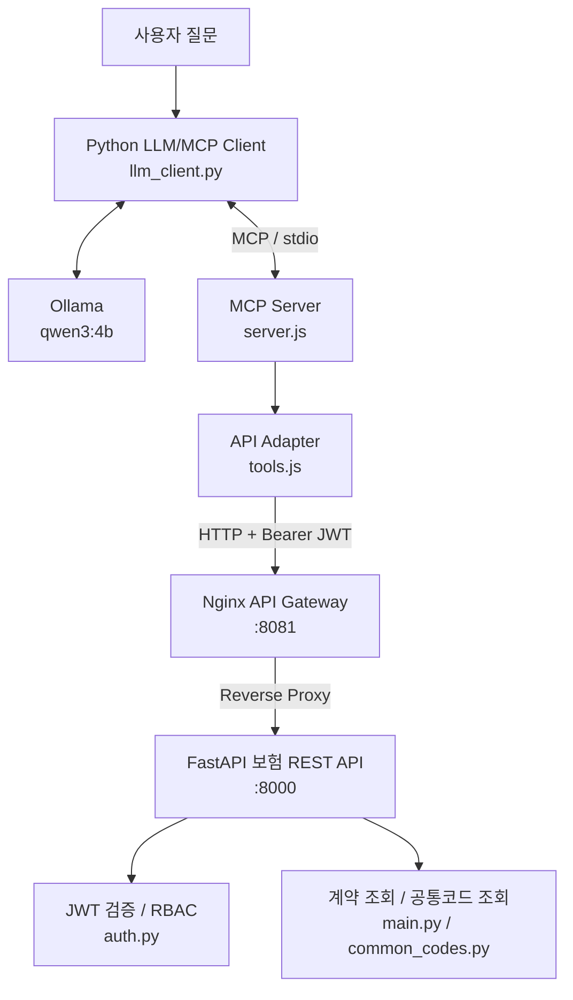

# Insurance LLM–MCP PoC

> 보험 업무 REST API와 로컬 LLM을 Model Context Protocol(MCP)로 연계하고, API Gateway와 인증·인가 및 트래픽 제어를 검증하는 아키텍처 PoC입니다.

## 1. 프로젝트 개요

보험 시스템의 기존 REST API를 LLM이 안전하고 표준화된 방식으로 활용할 수 있는지 검증하기 위해 구현했습니다. 사용자가 자연어로 보험 계약 또는 공통코드 조회를 요청하면, 로컬 LLM이 적절한 MCP Tool을 선택하고 MCP 서버가 보험 REST API를 호출합니다.

**주요 목표**

- 기존 보험 REST API의 변경을 최소화하면서 LLM 연계
- MCP를 통한 업무 기능(Tool) 표준화 및 LLM과 업무 API의 책임 분리
- Nginx API Gateway를 통한 요청 제어와 역방향 프록시 적용
- JWT 인증 및 역할 기반 접근제어(RBAC) 구현
- 로컬 환경에서 기능·연계·오류 시나리오 검증

> 학습 및 아키텍처 검증 목적의 PoC로, 실제 고객 정보나 운영 보험 시스템과 연결하지 않습니다.

## 2. 시스템 아키텍처



**요청 처리 순서**

1. 사용자가 보험 업무 관련 질문을 입력합니다.
2. `llm_client.py`가 MCP Tool 목록을 가져와 Ollama에 제공합니다.
3. Ollama가 질문에 적합한 Tool과 인자를 선택합니다.
4. MCP Client가 stdio 방식으로 `server.js`에 Tool 호출을 전달합니다.
5. `tools.js`가 Bearer JWT를 포함하여 보험 REST API를 호출합니다.
6. Nginx를 경유하도록 설정된 경우 Gateway에서 프록시 및 트래픽 제어를 수행합니다.
7. FastAPI가 JWT와 역할 권한을 검증하고 업무 데이터를 반환합니다.
8. Tool 결과를 전달받은 Ollama가 최종 자연어 답변을 생성합니다.

**중요:** `tools.js`의 `API_BASE_URL`을 `http://127.0.0.1:8081`로 설정해야 Nginx Gateway를 경유합니다. 기본값이 `http://127.0.0.1:8000`이면 FastAPI를 직접 호출하므로 Gateway 제어가 적용되지 않습니다.

## 3. 기술 스택

| 영역 | 기술 | 용도 |
| --- | --- | --- |
| LLM | Ollama, Qwen3 4B | 로컬 추론 및 Tool Calling |
| MCP Client | Python MCP SDK | Tool 탐색 및 호출 |
| MCP Server | Node.js, MCP SDK | 업무 Tool 등록 및 실행 |
| 업무 API | Python, FastAPI | 보험 REST API 제공 |
| API Gateway | Nginx | Reverse Proxy, Rate Limit, Timeout |
| 인증·인가 | JWT(HS256), RBAC | 토큰 검증 및 역할별 접근제어 |
| 형상관리 | Git, GitHub | 브랜치 기반 변경 관리 |
| 개발 환경 | macOS, VS Code | 로컬 개발 및 검증 |

## 4. 프로젝트 구조 및 소스 역할

```text
insurance-poc/
├── main.py                 # FastAPI 애플리케이션 및 보험 업무 API
├── common_codes.py         # 상품·계약상태 공통코드 API
├── response.py             # REST API 공통 응답 형식
├── auth.py                 # JWT 발급·검증 및 RBAC 검사
├── llm_client.py           # Ollama 연계 및 MCP Tool Calling
├── mcp_client.py           # MCP 연결·Tool 직접 호출 테스트
├── mcp-server/
│   ├── server.js           # 현재 사용 중인 stdio MCP 서버
│   ├── tools.js            # 보험 REST API 호출 어댑터
│   └── http-server.js      # HTTP 기반 MCP 확장용(현재 미사용)
├── nginx/                  # Gateway 설정 관련 파일
├── requirements.txt        # Python 의존성
├── package.json            # Node.js 의존성
├── package-lock.json       # Node.js 의존성 잠금 파일
└── .gitignore              # Git 추적 제외 대상
```

`http-server.js`는 HTTP 기반 MCP 연계를 위한 별도 구현이며 **현재 `llm_client.py`의 실행 경로에는 포함되지 않습니다.** 현재 클라이언트는 `server.js`를 하위 프로세스로 실행하고 stdio(표준 입출력)로 통신합니다. HTTP MCP 방식은 추후 별도 서버 배포 시 검토할 수 있습니다.

## 5. 주요 구현 기능

### 5.1 보험 업무 REST API

- 보험 계약정보 조회용 샘플 API
- 상품코드(`PRODUCT`) 및 계약상태코드(`CONTRACT_STATUS`) 조회
- 공통 응답 구조를 통한 처리 결과 및 오류 정보 표준화

### 5.2 MCP Tool 연계

- 보험 계약 조회 Tool 및 공통코드 조회 Tool 제공
- MCP Client에서 Tool 목록을 조회하고 입력 스키마를 LLM에 전달
- LLM이 선택한 Tool을 MCP 서버에서 실행하고 결과를 다시 LLM에 제공
- 업무 데이터는 Tool 결과에 근거해 답변하도록 프롬프트 구성

### 5.3 Nginx Gateway 및 트래픽 제어

- FastAPI 앞단 Reverse Proxy 구성
- Rate Limit 및 Timeout 설정을 통한 요청 제어
- 다중 요청 부하 테스트를 통해 HTTP 응답 확인
- Gateway 우회 여부는 `API_BASE_URL` 설정에 따라 달라짐

### 5.4 JWT 및 RBAC

- `JWT_SECRET_KEY` 환경변수로 HS256 서명 키 주입
- JWT에 사용자 식별자(`sub`), 역할(`role`), 발급시각(`iat`), 만료시각(`exp`) 포함
- 토큰 유효성 검증 및 역할 기반 API 접근 통제
- 인증 누락·잘못된 토큰은 401, 권한 부족은 403으로 처리
- 현재 구현의 JWT 만료시간은 30분

> PoC에서는 HS256 공유 비밀키를 사용합니다. 운영 환경에서는 키 보관·교체, 토큰 발급 주체, 감사로그, TLS, 최소권한 정책을 추가 설계해야 합니다.

## 6. 실행 방법 (macOS)

아래 명령은 프로젝트 루트에서 실행하는 예시입니다. 실제 토큰 발급 엔드포인트 및 계정 정보는 `main.py`의 현재 구현을 확인하세요.

### 6.1 저장소 준비

```bash
git clone https://github.com/samlee8482/insurance-poc.git
cd insurance-poc
python3 -m venv .venv
source .venv/bin/activate
pip install -r requirements.txt
npm install
```

Ollama를 설치한 후 모델을 준비합니다.

```bash
ollama pull qwen3:4b
```

### 6.2 환경변수 설정

```bash
# 예시 값: 실제 사용 시 충분히 긴 무작위 키를 생성하고 안전하게 관리
export JWT_SECRET_KEY="$(openssl rand -hex 32)"

# 아래 값은 실제 발급받은 JWT로 교체
export INSURANCE_API_TOKEN="<발급받은-JWT>"

# Nginx Gateway를 경유할 경우
export API_BASE_URL="http://127.0.0.1:8081"
```

**주의:** 환경변수는 프로세스에 전달되어야 합니다. 특히 `INSURANCE_API_TOKEN`과 `API_BASE_URL`은 `llm_client.py`가 시작하는 Node.js MCP 서버에도 상속되어야 합니다. 토큰과 비밀키는 Git에 커밋하지 마세요.

### 6.3 서비스 기동

터미널을 분리하여 다음 순서로 실행합니다.

**터미널 1 — Ollama**

```bash
ollama serve
```

Ollama가 이미 백그라운드에서 실행 중이라면 중복 실행할 필요가 없습니다.

**터미널 2 — FastAPI**

```bash
cd insurance-poc
source .venv/bin/activate
export JWT_SECRET_KEY="<터미널 간 동일한 서명키>"
uvicorn main:app --host 127.0.0.1 --port 8000
```

**Nginx — Gateway**

```bash
nginx -t
brew services start nginx
```

이미 실행 중이라면 `brew services restart nginx` 또는 설정 재로드 방식을 사용합니다. Nginx 설정에서 `8081` 리스닝과 `8000`으로의 프록시 전달이 구성되어 있어야 합니다.

**터미널 3 — LLM/MCP 통합 테스트**

```bash
cd insurance-poc
source .venv/bin/activate
export INSURANCE_API_TOKEN="<발급받은-JWT>"
export API_BASE_URL="http://127.0.0.1:8081"
python llm_client.py
```

`llm_client.py`가 `mcp-server/server.js`를 자동 실행하므로 **stdio MCP 서버를 별도 터미널에서 먼저 실행할 필요는 없습니다.**

### 6.4 기본 확인

```bash
# API 문서 확인
open http://127.0.0.1:8000/docs

# Gateway 경유 공통코드 API 확인 (보호된 API라면 JWT 필요)
curl -i \
  -H "Authorization: Bearer ${INSURANCE_API_TOKEN}" \
  http://127.0.0.1:8081/api/common/codes/PRODUCT/P001

# MCP Tool 직접 호출 테스트
python mcp_client.py
```

실행 전 확인사항: `mcp_client.py`의 테스트 인자와 환경변수는 현재 코드에 맞게 조정해야 합니다.

## 7. 테스트 시나리오

| 구분 | 테스트 | 기대 결과 |
| --- | --- | --- |
| REST API | 유효한 계약·공통코드 조회 | 정상 응답 |
| REST API | 존재하지 않는 공통코드 | 정의된 오류 응답 |
| MCP | MCP 서버 초기화 및 Tool 목록 조회 | Tool 목록 확인 |
| LLM | 자연어로 보험정보 조회 요청 | 적절한 Tool 선택 및 결과 기반 답변 |
| Gateway | 8081 포트 경유 API 호출 | FastAPI로 프록시 전달 |
| 트래픽 | 다중 동시 요청 | 설정된 제한에 따른 응답 제어 |
| 인증 | JWT 없이 보호 API 호출 | HTTP 401 |
| 인증 | 위조·만료 JWT 사용 | HTTP 401 |
| 인가 | 권한이 없는 역할로 호출 | HTTP 403 |

위 표는 검증 시나리오이며, 모든 항목의 자동화 테스트 통과를 의미하지는 않습니다.

## 8. 단계별 구현 이력

| Chapter | 구현 범위 |
| --- | --- |
| 1 | macOS 개발환경 및 Git/GitHub 준비 |
| 2 | 보험 REST API와 공통코드·응답 구조 구현 |
| 3 | MCP Server 및 업무 Tool 구성 |
| 4 | Ollama LLM과 MCP Client 연계 |
| 5 | Nginx Reverse Proxy 기반 API Gateway 구성 |
| 6 | Rate Limit, Timeout 및 부하 테스트 |
| 7 | JWT 인증과 RBAC 권한 통제 |
| 8 | LLM Tool Calling 및 JWT 전달 통합 검증 |

## 9. 아키텍처 설계 관점

**책임 분리:** LLM은 질문 해석과 Tool 선택을, MCP는 표준화된 Tool 인터페이스를, REST API는 보험 업무 처리와 접근제어를 담당합니다. LLM에 보험 업무 DB를 직접 노출하지 않습니다.

**기존 시스템 재사용:** 기존 REST API를 MCP Tool로 감싸는 어댑터 패턴을 사용하여 업무 시스템 변경 범위를 줄입니다.

**보안 경계:** JWT 서명 검증과 RBAC를 업무 API에서 수행합니다. MCP가 호출하더라도 최종 접근 권한은 API에서 판단해야 합니다.

**트래픽 보호:** Gateway에 요청 제한과 타임아웃을 적용해 비정상적이거나 과도한 호출이 업무 API에 미치는 영향을 줄이는 구조를 검증합니다.

**운영 확장 시 보완사항:** 인증 서버 연계, 비밀정보 관리, HTTPS/TLS, 감사로그, 분산 Rate Limit, 모니터링, 장애 대응, Tool 입력 검증, 프롬프트 인젝션 대응, 개인정보 마스킹 등이 필요합니다.

## 10. 현재 범위와 향후 개선

이 저장소는 **로컬 단일 환경 PoC**입니다. `http-server.js` 기반 원격 MCP 서비스, 운영 수준 고가용성, 분산 트래픽 제어, 중앙 인증 및 실제 보험 시스템 연계는 현재 운영 적용을 완료한 기능으로 간주하지 않습니다.

향후에는 원격 MCP 전환, 서비스 간 인증 체계, 구조화 로그·분산 추적, 컨테이너 배포, 자동화 테스트 및 성능 측정 지표를 확장할 수 있습니다.

---

**Repository:** https://github.com/samlee8482/insurance-poc
